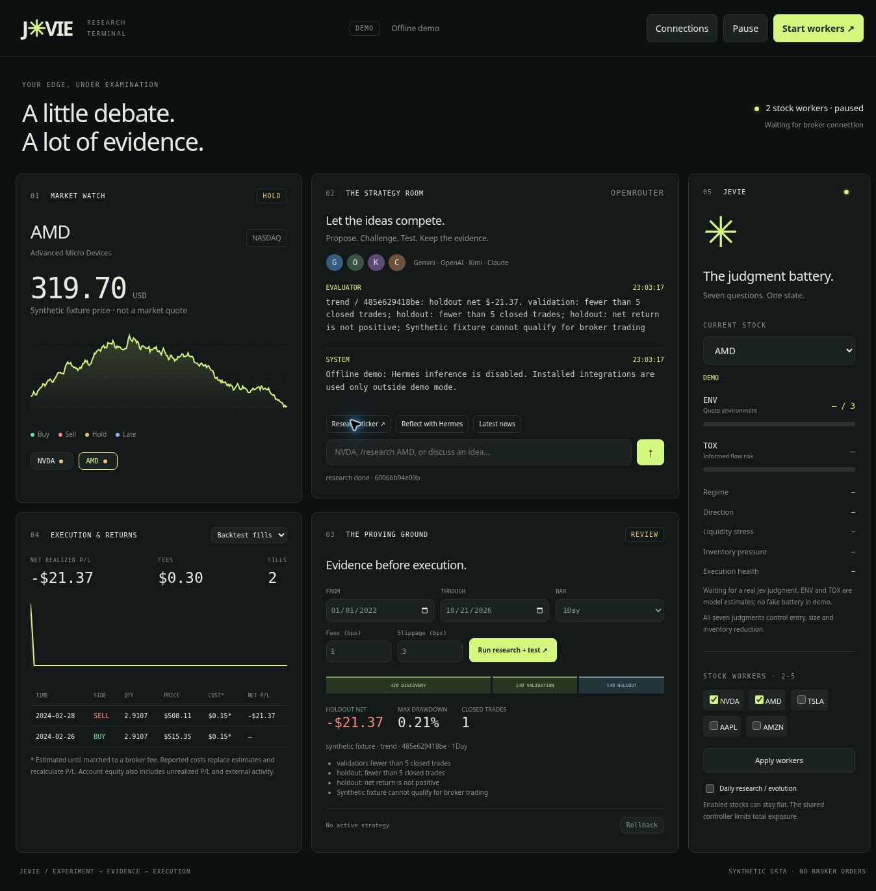

# Jevie / test2

A local research and trading terminal for **NVDA, AMD, TSLA, AAPL and AMZN** with **2–5 stock workers**, Alpaca execution, and **OpenRouter-only model inference**. Paper is the default; real-money execution needs explicit local activation.



## Try it

Python **3.11+** runs the terminal without pip dependencies:

```bash
python start_jevie.py --demo
```

Open **http://127.0.0.1:8765**, type `NVDA`, and select **Backtest fills** in panel 4. The offline demo uses labelled synthetic fixtures, makes no model calls and cannot submit broker orders. ENV and TOX remain empty without real Jev judgments.

For paper trading, copy `.env.example` to `.env`, add OpenRouter and Alpaca **paper** keys, then run `python start_jevie.py`. Select 2–5 workers, run research, inspect the report, then press **Start workers**. Every restart pauses new orders. An enabled worker can remain flat; two workers does not force two positions.

## What is implemented

| Capability | Implementation and verification boundary |
|---|---|
| Five panels | Market/status dots; strategy discussion; historical backtester; fills/fees/P&L; seven-answer battery and stock selector |
| Model variety | Four distinct free models from four providers by default; diversity checks require four IDs across four providers |
| Strategy invention | Models may write new Python indicators and buy/sell/hold rules, beyond the three retained baseline families |
| Iterative debate | Proposal, objections, validation, revision and consensus across 1–12 rounds per research budget; ongoing user discussion persists across turns |
| Hermes evolution | Official `AIAgent` installed and import-checked; per-stock lessons become inputs to later research. Authenticated reflection still requires your key |
| OpenBot | Complete pinned MIT source bundled in this repo; Jevie fork runs without CopilotKit Intelligence. PostgreSQL stores chat history and run leases; offline API/UI, chat and restart recovery verified |
| Alpaca paper/live | Separate hosts, credentials and databases; live launch and account checks implemented. No authenticated broker execution was performed during development |
| Actual fees | Broker activity ingestion, CSV import, explicit unmatched-fee assignment, partial-fill allocation and retrospective net P/L correction |
| All seven judgments | ENV, TOX, regime, direction, liquidity, inventory and execution health control orders; tests cover the engine's ENV entry block and protective exit |

### Final OpenRouter lineup

All model inference uses one **OpenRouter API key**. The strategy room uses four different model makers; Jev supplies trading judgments; Hermes uses a separate reflection session to improve later research.

| Role | Model | Exact OpenRouter ID | Job |
|---|---|---|---|
| Researcher | Google Gemma 4 31B | `google/gemma-4-31b-it:free` | Propose strategies and revisions |
| Challenger | Recursive Flint | `recursive/flint-v1.0:free` | Offer alternatives and challenge assumptions |
| Critic | Cohere North Mini Code | `cohere/north-mini-code:free` | Review strategy logic, costs and validation evidence |
| Decider | NVIDIA Nemotron 3.5 Super VL | `nvidia/nemotron-3.5-super-vl:free` | Select a candidate or request another experiment |
| Hermes evolver | NVIDIA Nemotron 3.5 Super VL | `nvidia/nemotron-3.5-super-vl:free` | Reflect through Hermes and save per-stock lessons |
| Jev / Jevie | Typesafe Jev 1.14 — **paid** | `typesafe/jev-1.14` | Seven trading judgments through the Decisions API |

OpenBot's interface model also defaults to the same free NVIDIA model. Its installer and launcher share the central defaults in `jevie_models.py`. OpenBot routes research to the four-model team; Hermes reflections do not replace Jev's trading judgments. Tested strategy rules, Jev judgments and code-owned risk controls jointly determine orders.

The four `:free` IDs and their zero input/output token prices were checked against [OpenRouter's catalog](https://openrouter.ai/api/v1/models) on 2026-10-22. Free routes have availability and request limits; they do not promise unlimited or uninterrupted service. See [OpenRouter's limits](https://openrouter.ai/docs/api-reference/limits). **Jev is paid**, using the same key; an account's daily spending ceiling is not free credit or a target budget. This update does not add a monetary spending cap. Round budgets bound debate work, not total daily cost. The default lineup never switches to a paid replacement when a free route fails; errors are surfaced and research stops. You can explicitly choose other models in Connections, including paid models. A missing fresh Jev judgment blocks new entries.

The catalog picker includes text models across providers. Strategy-room badges follow configured selections, and messages show the returned model ID. On the first launch after this update, stored roles still set to the former defaults migrate to this lineup; custom IDs are preserved. Later explicit selections are retained across restarts. The listed defaults are configured, **not evidence that authenticated inference has run**. Review each provider's data policy before sending private information; the [free NVIDIA route](https://openrouter.ai/nvidia/nemotron-3.5-super-vl:free) may use prompts and outputs for model improvement.

OpenRouter is the only **model service**. Alpaca still needs broker credentials, and Supabase supplies the PostgreSQL database. **No CopilotKit Intelligence API key, license token or subscription is required by this fork.** The complete OpenBot source is bundled in `vendor/openbot-source.tar.gz`; `openbot_local/` contains the reproducible changes. See [the setup guide](INTEGRATIONS.md#openbot-without-copilotkit-intelligence). Hosting and OpenRouter usage remain subject to their own limits; Jev remains paid.

## ENV and TOX from the supplied Jev loop

Your supplied prompt explicitly supports crypto **and US equities**. ENV scores the quote environment from 0–3; TOX estimates informed aggressive flow from 0–1. TOX is applicable to stocks, including adverse selection and liquidity stress. The current input is completed bars, top-of-book quotes, inventory and execution history. It does not contain full market depth or aggressor-labelled trades, so TOX is a model judgment, not a measured VPIN statistic or a calibrated probability.

This implementation trades long/flat positions. It adapts the original market-making policy to entry eligibility, size ceilings, cancellation of pending buys and inventory reduction; it **does not post two-sided quotes**.

- TOX above 0.60 or liquidity stress above 0.70 blocks new buys and cancels Jevie's pending buys while workers run.
- ENV below 1 or confidence below 0.50 blocks entry. Full size requires ENV at least 2 and confidence above 0.80; intermediate evidence halves size.
- Crisis blocks entry; a sufficiently confident crisis can reduce held inventory. High volatility halves the size ceiling.
- Confident downward direction blocks new long entry.
- High inventory pressure can trigger an exit; poor execution health blocks or reduces entry.
- Stale judgments block entry. Code-owned stop exits can still act independently of ENV/TOX, provided data is fresh and trading is running.

## Research, invention and automatic implementation

The models initially receive discovery history only. Two proposers invent or revise candidates, the code backtests validation, a critic examines the results, and a decider either asks for another experiment or freezes an existing candidate. A round budget is a cost limit, not a fixed four-message script. Running out without consensus makes the result diagnostic only. Plain chat messages continue a persistent discussion; chat itself never deploys a strategy.

Free-form strategies define `decide(bars, position, parameters)`. They receive at most 2,000 past bars and return buy/sell/hold. Python `math`, `statistics` and selected builtins are available. Global state should not be used; it is reset between decisions. Strategies cannot set order size beyond the code-owned allocation cap, change evaluation rules or obtain broker keys.

On Linux, generated code runs in a separate, credential-free process under resource limits and a default-deny seccomp filter. File opens, sockets, process creation and execution are denied. Windows/macOS require Docker and a locally available `python:3.12-slim` image; the fallback uses no network, a read-only filesystem, resource limits and a single worker-file mount. If isolation is unavailable, custom strategy execution fails closed. The Docker fallback was not exercised in this build environment. This is bounded strategy invention, not unrestricted access to your computer or broker.

First experiments split history 60% discovery / 20% validation / 20% holdout. Signals use the preceding completed bar and fills use the next open. Fees and slippage apply on both sides. Each candidate must have at least five closed trades, positive cost-adjusted P/L and at most 10% drawdown in both validation and holdout. These are engineering filters, not a claim of a durable edge.

A holdout can qualify a strategy only once. Later qualification requires at least 80 newly accumulated bars; previously seen history supplies discovery and validation. Until enough new bars accumulate, replays are diagnostic. Research changes neither that boundary nor risk limits. Accepted versions activate automatically only when the worker is flat and has no unresolved order. Rollback has the same condition.

With daily bars, 80 new observations takes months. Daily automatic research is optional and advances history through yesterday. Current news is available separately through `/news`; it is excluded from historical hypothesis selection. Backtests do not model queue priority, intrabar fills, market impact, dividend cash flows or uncertain fills. Live polling can produce different results.

## Real-money mode

Paper mode never switches to live from chat or the dashboard. Put separate live keys in `.env` and explicitly opt in:

```dotenv
ALPACA_LIVE_API_KEY=your-live-key
ALPACA_LIVE_SECRET_KEY=your-live-secret
JEVIE_ENABLE_LIVE=I_UNDERSTAND_LIVE_ORDERS
```

Then launch:

```bash
python start_jevie.py --live --confirm-live LIVE-ORDERS
```

The dashboard says **LIVE**, uses `runtime/live`, and still starts paused. **Start LIVE orders** validates the broker account before starting. No live orders were sent while building or testing this project.

Orders are long/flat, at most 20% of equity per stock and 80% gross exposure, with cash and pending-buy reservations. Tradability/fractional eligibility, market clock, quote freshness, spread and battery gates apply. Client order IDs and durable intents prevent blind retries; partial fills are reconciled idempotently. A manual/external position mismatch stops that worker.

A persistent 10% account high-water drawdown latch stops new orders and attempts to cancel Jevie open orders. It does **not** liquidate existing positions. Pause also leaves positions and existing orders in place. This is not an exchange-held stop or a guaranteed loss bound. Do not run multiple independent controllers against the same account; the 2–5 workers share one portfolio controller.

## Actual fees and P/L

Jevie polls Alpaca FEE/CFEE account activities. A reported charge with a matching order ID replaces that order's estimates and is apportioned across partial fills. The entire owned-fill ledger is recalculated so a late entry charge also corrects an already closed trade's P/L. Rows still awaiting actual attribution retain an asterisk and their estimated cost. Paper trading normally uses configured hypothetical costs.

Account-level charges without an order link remain **unmatched**, rather than being guessed onto a stock. **Connections** shows their IDs and the filled order IDs. After checking your statement, use `/assignfee ACTIVITY_ID ORDER_ID`. CSV import supports `id,date,net_amount,order_id,symbol,activity_type,currency`; `net_amount` is negative for a charge and positive for a rebate. Repeated IDs update rather than duplicate records. Non-USD fees require a USD conversion record and are never treated as dollars automatically. Initial API sync requests 30 days, then overlaps seven days; import older or unusually delayed charges from a statement.

Broker fills already include execution slippage, so it is not charged twice. Net realized trade P/L includes both entry and exit costs. The account equity curve also includes unrealized P/L, deposits, withdrawals and external activity. Unmatched fees are shown separately and are not silently deducted from a ticker.

## Hermes and OpenBot

See [INTEGRATIONS.md](INTEGRATIONS.md). Hermes uses its pinned official source; OpenBot uses the bundled upstream source with the documented Jevie runtime fork. Hermes reflects on evidence and writes per-stock research lessons. It evolves instructions and subsequent strategy proposals, not model weights or risk code. OpenBot uses its supported remote AG-UI coworker architecture and the same Jevie engine, state and controller. OpenBot does not create a second trading loop.

## OpenBot without an Intelligence key

```bash
python setup_integrations.py --install-openbot
python run_openbot.py --check
python run_openbot.py
```

Set `OPENROUTER_API_KEY` and the Supabase **Session pooler PostgreSQL connection string** as `DATABASE_URL` in your local `.env`. The URL comes from Supabase **Connect → Session pooler** and uses port **5432**. It is not the project HTTPS URL or publishable key. The schema has already been installed in the connected Jevie Supabase project; the launcher verifies it on startup. Start Jevie in a second terminal, then open **http://127.0.0.1:3010**. Detailed instructions and verification limits are in [INTEGRATIONS.md](INTEGRATIONS.md).

This is a local, single-operator application. It supports 2–5 Jevie stock workers under one OpenBot controller. PostgreSQL persists OpenBot conversations; Jevie keeps trading state and Hermes lessons in its existing local stores. Hermes supplies strategy reflection. Hosted Intelligence Learning, managed channels and enterprise services are not recreated or included.

## Commands and tests

`NVDA`, `/research AMD`, `/debate TSLA`, `/backtest AAPL`, `/evolve NVDA`, `/news AMZN`, `/fees`, `/assignfee ACTIVITY_ID ORDER_ID`, `/status`, `/start`, `/pause`, `/rollback NVDA`, `/help`.

Plain messages such as “Compare momentum with a volatility filter” continue discussion for the selected stock. `/research`, `/debate` and `/backtest` all run the evaluated pipeline; none skips the holdout gate.

```bash
python -m unittest test_jevie test_upgrades -v
python run_openbot.py --check
# Optional complete OpenBot offline integration check (after installing OpenBot):
npm ci --prefix openbot_local
node openbot_local/smoke.mjs
```

The OpenBot check boots its real API/UI, calls the real Jevie AG-UI endpoint, verifies saved chat after database/API restart, and checks ownership, competing leases and failed writes using a local PGlite PostgreSQL test engine. It needs no API keys and places no orders. Production uses PostgreSQL/Supabase, not PGlite.

Tests cover chronology, holdout reuse, generated-code isolation/timeouts, model diversity/revisions, all seven policy inputs, ENV order control, live endpoint gating, actual-fee arithmetic, partial fills, persistent state, HTTP protection and AG-UI streaming. Automated checks and offline browser QA do not establish trading profitability or authenticated service readiness. Supply credentials locally to test those integrations. `.env`, broker state, runtime lessons and downloaded dependencies are excluded from Git.
